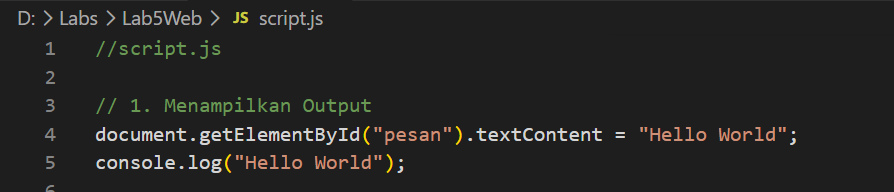
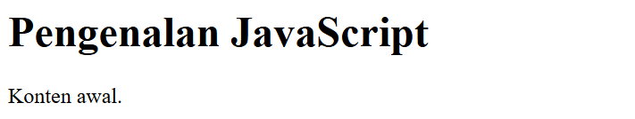
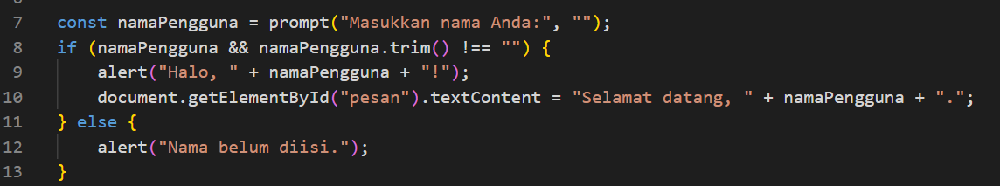
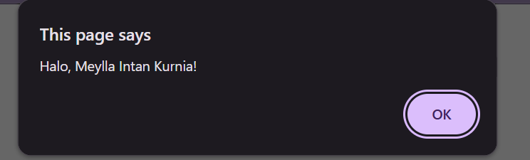
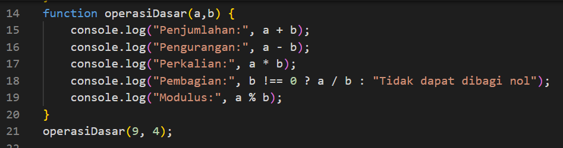
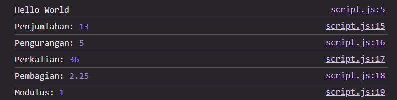
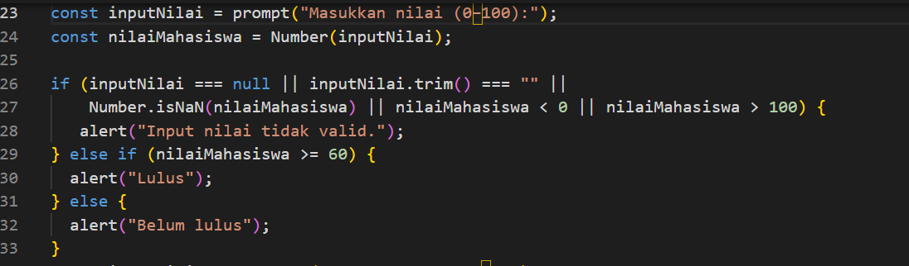
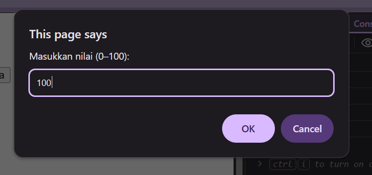
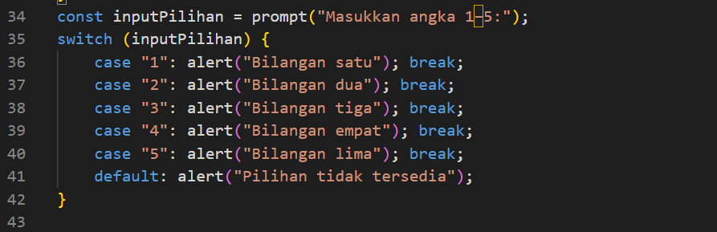
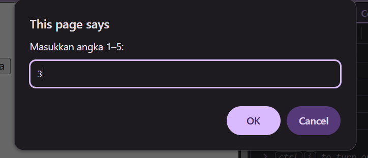

# Lab5Web

## JavaScript Dasar dan Manipulasi HTML

JavaScript adalah bahasa pemrograman yang digunakan untuk membuat halaman web menjadi lebih interaktif. Dengan JavaScript, kita dapat mengubah isi HTML, menerima input dari pengguna, menampilkan pesan, dan melakukan perhitungan.

## 1. Menampilkan Output

Pada bagian ini, kita membuat file dengan nama `script.js` untuk menampilkan tulisan pada halaman HTML dan Console browser.

```javascript
document.getElementById("pesan").textContent = "Hello World";
console.log("Hello World");
```


**Penjelasan:**
- `document.getElementById("pesan")` digunakan untuk mencari elemen HTML yang memiliki ID `pesan`.
- `textContent` digunakan untuk mengubah teks yang ditampilkan pada halaman web.
- `console.log()` digunakan untuk menampilkan pesan pada Console browser.

.png)

## 2. Alert dan Prompt

Pada bagian ini, kita belajar menerima input nama pengguna dan menampilkan pesan menggunakan JavaScript.

```javascript
let nama = prompt("Masukkan nama Anda:");
alert("Halo, " + nama + "!");
```


**Penjelasan:**
- `let nama` digunakan untuk membuat variabel untuk menyimpan nama.
- `prompt()` digunakan untuk menampilkan kotak input kepada pengguna.
- `alert()` digunakan untuk menampilkan pesan dalam kotak dialog.
- Tanda `+` digunakan untuk menggabungkan teks dengan nama yang dimasukkan.

Contohnya, jika kita memasukkan nama Meylla Intan Kurnia, maka akan muncul pesan:

`Halo, Meylla Intan Kurnia!`

## 3. Function dan Operasi Aritmatika

Function adalah bagian kode yang dibuat untuk menjalankan tugas tertentu. Dalam JavaScript, function dapat digunakan untuk melakukan operasi aritmatika seperti penjumlahan, pengurangan, perkalian, pembagian, dan sisa bagi.

Contoh kode:

```javascript
function penjumlahan(a, b) {
    return a + b;
}

console.log(penjumlahan(10, 5));
```


**Penjelasan:**
- `function penjumlahan(a, b)` digunakan untuk membuat fungsi penjumlahan.
- `return a + b` digunakan untuk mengembalikan hasil penjumlahan dua angka.
- `console.log()` digunakan untuk menampilkan hasilnya.


## 4. Seleksi Kondisi If-Else

If-else adalah struktur kondisi yang digunakan untuk menentukan tindakan berdasarkan suatu kondisi.

Contoh kode:

```javascript
let nilai = 75;

if (nilai >= 60) {
    console.log("Lulus");
} else {
    console.log("Tidak Lulus");
}
```


**Penjelasan:**
- `let nilai = 75` digunakan untuk menyimpan nilai.
- `if (nilai >= 60)` memeriksa apakah nilai lebih besar atau sama dengan 60.
- `console.log("Lulus")` dijalankan jika kondisi benar.
- `else` dijalankan jika kondisi salah.

.png)
Karena nilai yang dimasukkan adalah 100, maka hasilnya adalah `Lulus`.

## 5. Seleksi Kondisi Switch

`switch` adalah struktur kondisi dalam JavaScript yang digunakan untuk memilih satu tindakan dari beberapa pilihan berdasarkan nilai suatu variabel.

**Penjelasan:**
- `let` digunakan untuk menyimpan nomor.
- `switch` digunakan untuk memeriksa nilai variabel.
- `case 1`, `case 2`, dan seterusnya merupakan pilihan kondisi yang akan diperiksa.
- `break` digunakan untuk menghentikan proses setelah kondisi yang cocok dijalankan.
- `default` dijalankan jika tidak ada pilihan yang sesuai.
- `console.log()` digunakan untuk menampilkan hasil pada Console browser.

**Hasil yang ditampilkan:**

.png)
```text
bilangan 3
```

## Kesimpulan

Melalui praktikum ini, kita dapat mempelajari dasar-dasar JavaScript, mulai dari menampilkan output, menerima input pengguna, menggunakan function, melakukan operasi aritmatika, hingga membuat kondisi if-else. Materi ini menjadi dasar untuk membuat halaman web yang lebih interaktif.